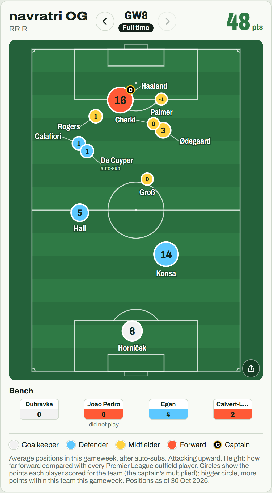
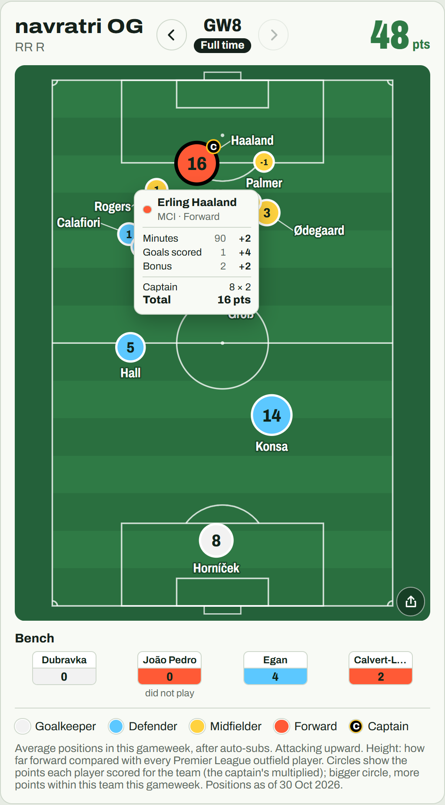
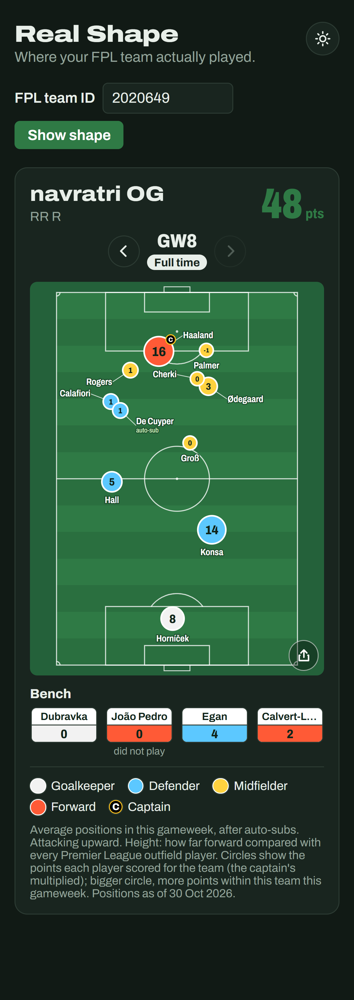

# FPL Real Shape

**See where your Fantasy Premier League team actually played.** Enter your FPL team ID and get your team drawn on a pitch at the real average positions your players took up in each match, instead of FPL's tidy formation. Each circle shows the points the player scored for you, hover or tap one to see how those points add up, step through every gameweek, and share the graphic as an image.

**Try it: https://fpl-real-shape.vercel.app**

## Why
FPL shows every team as a neat 3-4-3 or 4-4-2, but that's not how anyone actually picks. Managers load up on attacking "defenders" who play like wingers and "midfielders" who play as strikers, so most FPL teams are far more lopsided than the formation suggests. Real Shape uses real per-match average positions to show the shape your team actually played, where it bunches up and how far forward it really leans, and makes it easy to share (and laugh at) with your mini-league.

## What it looks like
My team in gameweek 8:

| The gameweek card | Hover / tap a player: points breakdown | Phone, dark theme |
|---|---|---|
|  |  |  |

Running it yourself: [`docs/setup.md`](docs/setup.md). Project progress: [`tasks/PROGRESS.md`](tasks/PROGRESS.md).

## License
The code is released under the [MIT License](LICENSE).

Team, player and points data come from the public Fantasy Premier League API, and average positions from Sofascore; that data belongs to its owners and is not covered by this license. This is a fan project, not affiliated with the Premier League, Fantasy Premier League or Sofascore.
